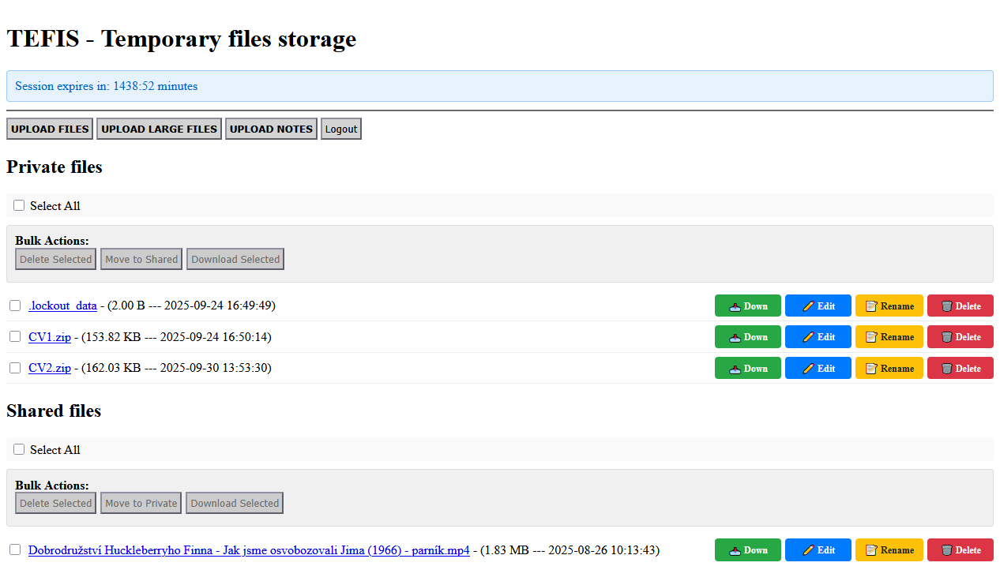
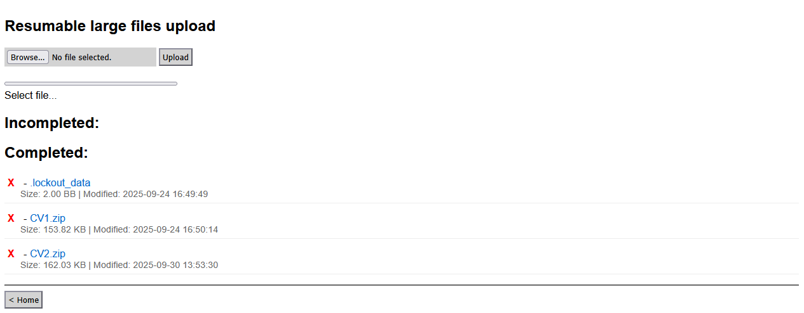
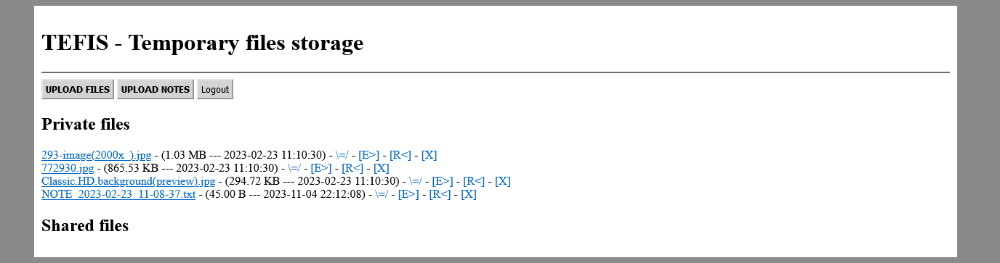
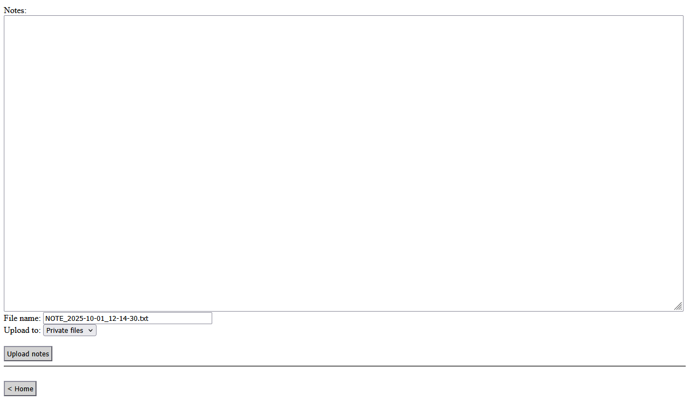

# TEFIS - Temporary files storage
Save files from someone else's computer without login to your important accounts.
- Private Files - you need to be logged in to see these files
- Shared Files - files can be view by url link without login

## TEFISv3
- Advanced auth security
- Files bulk operations added
- Upload status bar added
- Resumable upload of large files
 

 

## TEFISv2
This version is using PHP Sessions for user authentication. User doesn't have to login with each request.

## TEFISv1
Login to the system is not using sessions. You have to type your credentials for every request.
 

 

## Installation
Copy this code to your secure web server and change default login details in file `index.php`.

## TODO
- add support for directories
